# Just Simple Calendar

**The purpose is to make a calendar as lightweight and simple as possible, with no external libraries and no dependency on other community plugins.** That is why Just Simple Calendar exists: a small, focused way to see your notes on a calendar, using the features already built into Obsidian.

It adds **four calendar view types to Bases**, including a day/week agenda. Your notes remain ordinary Markdown files, your dates remain ordinary properties, and your Base keeps control of filtering and sorting. There is no separate event database, calendar framework, React runtime, account, or remote service.

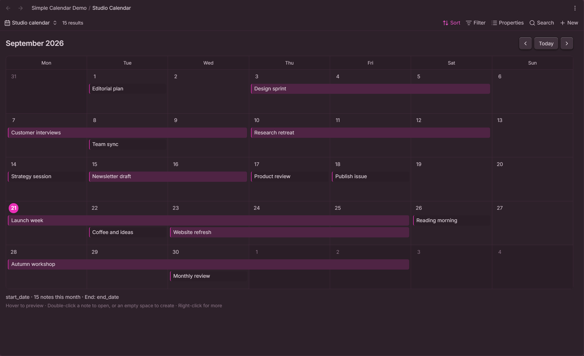

## Small by design

- Monthly calendar with **Previous year**, **Previous month**, **Today**, **Next month**, and **Next year**.
- A second **Infinite Calendar** view: scroll up into the past or down into the future through a continuous stream of weeks.
- A **Linear Calendar** view: a whole year with one month per row and aligned weekdays.
- A **Simple Agenda** view: complete note titles, optional times and accessible actions in a single column, showing one day or one week.
- A selectable start date and an optional, inclusive end date.
- An optional title property instead of the file name, with automatic fallback for missing or blank values.
- An optional color property: eight native color names or a custom hex color.
- Continuous bars for multi-day notes, with a continuation marker when they cross a week.
- Separate lanes for overlapping notes.
- Native hover previews and a configurable double-click action: open, new tab, or right-hand pane.
- Drag notes to another day on desktop, updating their date properties and preserving multi-day durations.
- Drag the right edge to change a note's end date, or add one to a single-day note.
- Right-click actions to open, open in a new tab, open to the right, or delete.
- Create a blank note from an empty day with its date already filled in.
- Monday or Sunday week start, keyboard support, and styling that follows your theme.

The JavaScript is less than **40 KiB uncompressed**, including the agenda and optional date-picker editors. The plugin has **zero runtime package dependencies**; only Obsidian's own API is external to the bundle. Development tools are not shipped with the plugin.

## Install

Requires **Obsidian 1.10.2 or later**, with the built-in **Bases** feature enabled. Enable the built-in **Page preview** feature if you want hover previews. These are Obsidian core features, not additional community plugins.

1. Open **Settings → Community plugins → Browse** in Obsidian.
2. Search for **Just Simple Calendar**.
3. Select **Install**, then **Enable**.

## Set up a calendar

1. Create or open a Base.
2. Open its view settings and choose **Simple Calendar** for a month, **Infinite Calendar** for continuous weeks, **Linear Calendar** for a year, or **Simple Agenda** for a day/week list.
3. Set **Date property** to your start date property, such as `start_date`.
4. Optionally set **End date property (optional)** to `end_date`.
5. Optionally set **Title property (optional)** to the property you want to display, such as `title`.
6. Optionally set **Color property (optional)** to a text property such as `color`.
7. Choose **First day of week**: Monday or Sunday.
8. Choose **Double-click action**: **Open note** (default), **Open in new tab**, or **Open to the right**.

Each view saves its own settings inside the `.base` file. You can use different date properties in different views of the same notes.

Use the double-arrow buttons **«** and **»** to jump backward or forward one year while keeping the same month. The single arrows move one month, and **Today** returns to the current month. Thanks to [u/anchovybird](https://www.reddit.com/user/anchovybird/) for suggesting faster navigation to previous years.

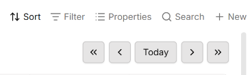

The title property changes the label shown on the calendar, including multi-day bars. You can select a text property, `aliases`, or a formula. Leave the selector unset to use file names; missing, empty, or whitespace-only values also fall back to the file name. Thanks to [u/Nyrazoth](https://www.reddit.com/user/Nyrazoth/) for suggesting custom calendar titles.

Wikilinks such as `"[[Project plan|Launch plan]]"` and Bases link values display their readable labels as clickable links, including links in lists. Click a link to follow its destination using Obsidian's normal link behavior. The surrounding card still belongs to the original note: double-click its background to use the configured opening action, or right-click it for note actions. Plain aliases remain labels for the original note. Linear Calendar keeps single-day blocks text-free, with the readable title in their tooltip.

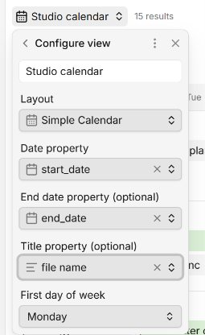

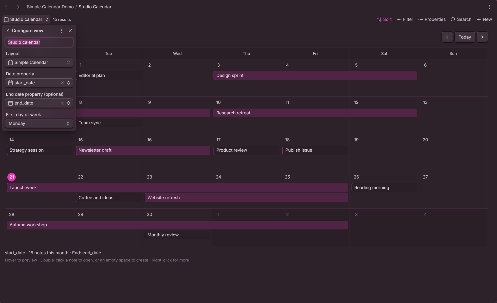

A note can be as simple as:

```yaml
---
start_date: 2026-09-21
end_date: 2026-09-25
---
```

Property names are your choice. There are no required folders, tags, templates, or naming conventions.

## Event colors

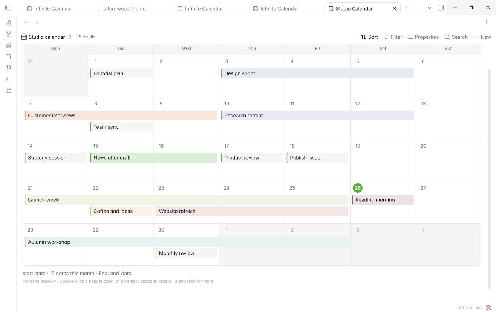

In any of the three views, select **Color property (optional)** and choose a text property such as `color`. The property name is up to you; each view saves its own selection.

Use one of Obsidian's eight palette names: `red`, `orange`, `yellow`, `green`, `cyan`, `blue`, `purple`, or `pink`. Names are case-insensitive and use your theme's palette, including its light and dark variants.

```yaml
---
start_date: 2026-09-21
end_date: 2026-09-25
color: blue
---
```

For a custom color, use three or six hexadecimal digits, for example `color: "#F80"` or `color: "#E57373"`. **Quote hex values in YAML** so the `#` is not treated as a comment.

The chosen color is used for the border and a soft background tint; text keeps the theme's normal text color. Hovering slightly strengthens the tint. Colors apply to every segment of a multi-day note and to single-day notes, including the text-free blocks in Linear Calendar.

Leave the selector unset to keep the existing appearance. Missing, blank, invalid, or non-text values also use the default appearance. Numeric `rgb(12, 34, 56)` and `rgba(12, 34, 56, 0.4)` values are supported, including percentage channels. Other CSS formats and alpha hex values are unsupported. The calendar only reads this property; it does not rewrite notes or add a color to newly created notes.

Thanks to [u/Quirky_Departure_409](https://www.reddit.com/user/Quirky_Departure_409/) for requesting event colors based on a frontmatter property.

## Multi-day notes

The start and end days are **both included**. September 21 through September 25 occupies five days and appears as one continuous bar. A range crossing a week has one segment per calendar row, with arrows indicating continuation. The title appears once per segment.

- No end property selected, or no end value on a note: one day.
- End date equals the start: one day.
- End date is invalid or earlier than the start: the note stays on its start day, with an explanatory count below the calendar.
- Invalid or missing start date: the note is counted below the calendar but is not placed on a day.

Month totals count **distinct notes**, not the number of occupied days. Ranges are clipped to the visible weeks, so a long-running note does not generate off-screen calendar cells.

## Simple Agenda

Choose **Simple Agenda** in the Base's view settings. Use **Day / Week**, the previous/next buttons, **Today** or the native date picker. The selected period is saved in this Base view. Week boundaries follow your Monday/Sunday setting.

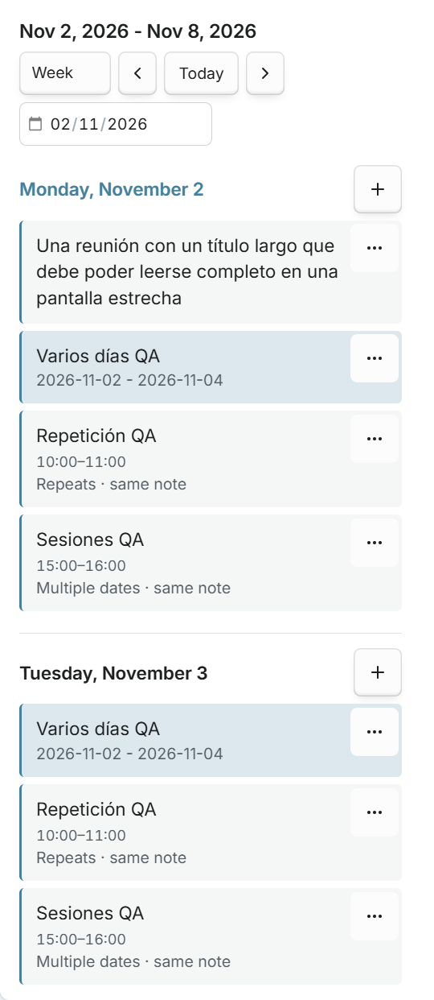

Each day has its own **+** button to create a dated note. Click or tap a note to open it; use its **three-dot button** for opening options, deletion and any optional schedule editors enabled in this view. Keyboard opening and native hover previews also work. Empty days stay visible so you can plan them.

All-day notes appear before timed notes; notes with the same start time retain the Base's order. A multi-day note appears on each occupied day, with its full date range. Repeated and additional-date appearances identify that they open the same note. No note is duplicated. The footer counts distinct notes and, when different, occurrences.

The agenda uses a single column at every width and wraps full titles. It does not add an hourly grid or drag gestures. Use the note's normal Properties editor to change its main date; the existing calendar views keep their desktop drag/resize controls. This screenshot is from desktop Obsidian in a narrow pane, not a physical phone.

## Infinite Calendar

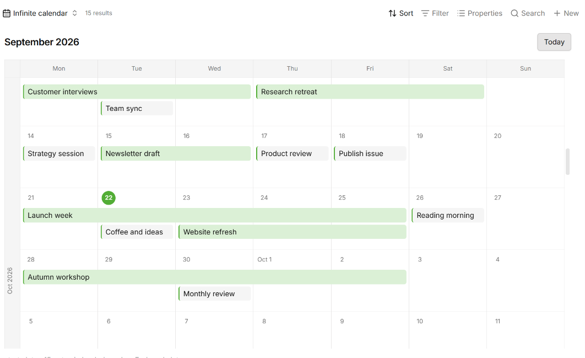

Choose **Infinite Calendar** as a second Bases view type when you want to focus on weeks rather than separate months. Scroll upward into the past or downward into the future. Weekday headings stay visible; month/year markers appear in the left margin, and the first day of each month includes its abbreviated month name. **Today** returns to the current week.

It uses the same date and title properties, week-start setting, previews, and note actions as Simple Calendar. Weeks continue across month and year boundaries without duplicating days. Multi-day notes remain continuous within each week.

Only a bounded window of weeks is rendered. As that window moves, the visible week and its position are preserved, including when weeks have different heights. The footer counts distinct notes in the loaded weeks, not the entire Base.

Thanks to [u/DudPug](https://www.reddit.com/user/DudPug/) for suggesting a continuous, scrollable calendar focused on weeks.

## Linear Calendar

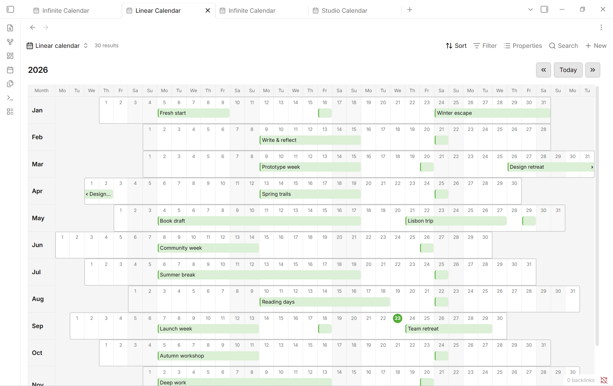

Choose **Linear Calendar** for a yearly overview with one month per row. Each month starts under its correct weekday, so weekends align vertically. Use **Previous year**, **Today**, and **Next year** to navigate. Monday and Sunday week starts are supported.

Multi-day notes form continuous bars across a month, with continuation markers when they cross into another month or year. Overlapping notes occupy separate lanes; busy months grow to fit them. Date and title properties, hover previews, and all note actions work just like the other views. Single-day notes appear as colored blocks without visible text; hover to read the title or preview the note. Their full titles remain available to screen readers. Multi-day bars keep their labels.

Each month's days have a slightly stronger outline so the twelve horizontal month bars are easy to distinguish. The weekday header and month labels stay visible while scrolling. Narrow panes scroll horizontally to keep dates readable. This view omits the footer and bottom padding to give the calendar as much room as possible.

Thanks to [u/Quirky_Departure_409](https://www.reddit.com/user/Quirky_Departure_409/) for suggesting a yearly linear view, and to Nick Milo for explaining this approach in his [Linear Calendar video](https://www.youtube.com/watch?v=SQHYj7x-t3A): seeing the whole year helps you spot busy periods and make room for what matters.

## Open, preview, and manage notes

Hover anywhere on a note or bar to preview it on desktop. By default no Ctrl/Cmd key is needed; this can be changed in **Settings → Page preview → Just Simple Calendar**.

In the view settings, **Double-click action** chooses whether a desktop double-click opens the note in the current pane, a new tab, or a pane to the right. The default is **Open note**, and each view saves its own choice. This applies to the card, including plain custom titles and aliases; a clickable link inside a title follows its own destination. On mobile, tap the card once to open it in the current pane. A right-click on the note offers the actions below:

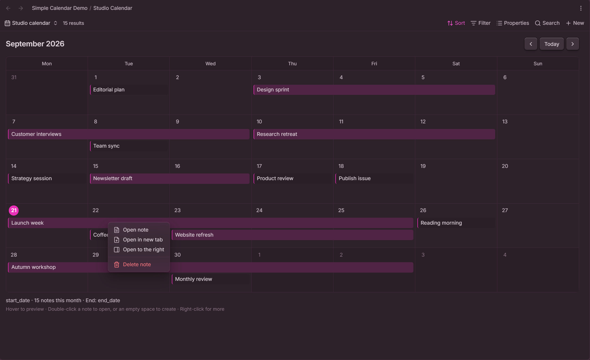

### Keep the calendar beside your note

Choose **Open to the right** to open a note beside the calendar. The calendar reuses the pane it created while that pane remains open, so browsing several notes does not keep splitting the workspace.

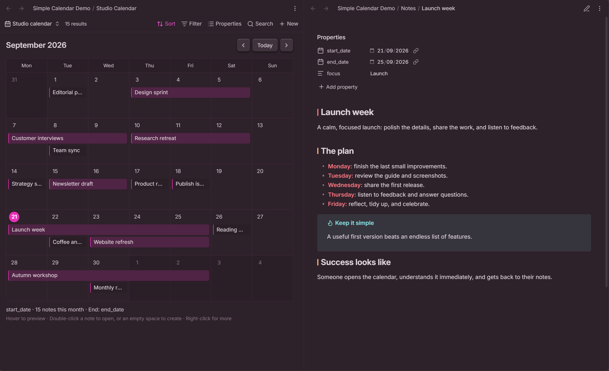

### Create a note on a day

Double-click empty space inside a day, or right-click it and choose **Create note on YYYY-MM-DD**. Bases creates a blank note and opens its native editor so you can give it a name and start writing.

The selected start date property is already filled in. The folder, unique filename, and other filter-derived properties follow Bases' own creation behavior. A new note may still be excluded by a restrictive filter; the plugin does not override your Base's filters.

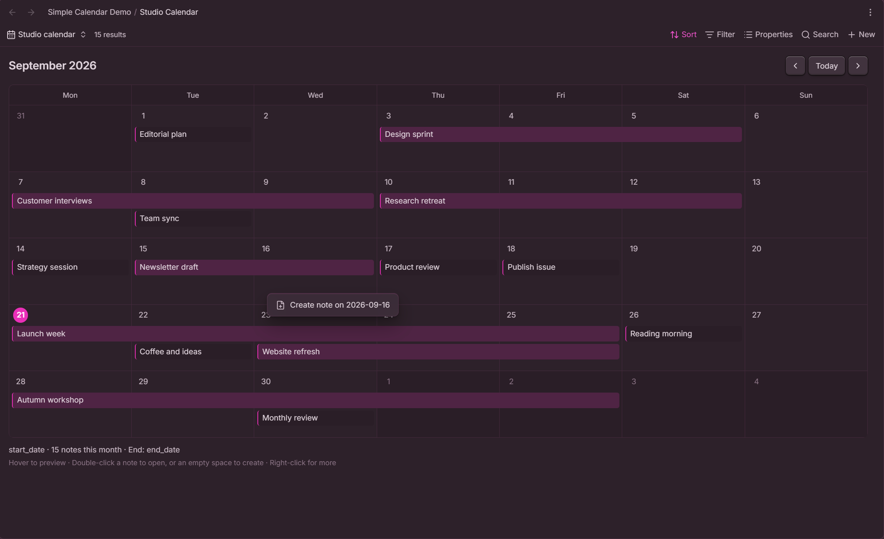

Creation requires a writable note property. File creation/modification dates and formula results can be displayed, but cannot be assigned by the calendar.

### Move a note to another date

On desktop, drag a card to another day in any of the three views. The destination day is highlighted. Dropping updates the selected start property in the note's frontmatter; if the note has an end date, both dates shift by the same number of calendar days to preserve its duration. Grab any day of a multi-day bar, including a continuation, and that day follows the pointer to the destination.

The rest of the note is preserved. Datetime values keep their written time and UTC offset. Dropping on the same day, pressing Escape, or dropping outside the calendar leaves the note unchanged. Scroll to bring another date into view during a drag; Infinite Calendar keeps its loaded weeks stable until the drag finishes, then resumes its normal continuous scrolling.

Moving requires writable note date properties. File dates, formulas, invalid date ranges, and a computed end property cannot be dragged. If a date changes in the file while you are dragging, the move is cancelled so it does not overwrite that edit. Moving a note can also make it leave the Base's current filters. Touch dragging is not supported.

Thanks to [u/HowlOfTheSun](https://www.reddit.com/user/HowlOfTheSun/) for requesting drag-to-reschedule and reporting links that were shown as raw text in custom titles.

### Resize a note's duration

Set **End date property (optional)** in the view settings to enable resizing on desktop. Hover over a card's right edge and drag the small handle to its new last day. The proposed date range is highlighted while you drag. Dropping updates **only the end date**; the start date stays unchanged. You can extend a note or shorten it down to a single day, but not end it before it starts.

**The note does not need an end date yet.** If it has none, resizing creates the selected end property on that note. Without an end property configured in the view, the resize handle is hidden. Start and end must be valid, distinct, writable note properties; a single-day note may have an empty end value.

For notes spanning several rows, use the handle on the final segment, where the note actually ends. Resizing works across visible weeks and months in all three views. Existing end datetimes keep their time and UTC offset. Cancelled drags and concurrent date edits leave the note unchanged, just as when moving a card.

### Delete a note

Right-click a note and choose **Delete note**. This deletes the underlying note file using Obsidian's configured deletion preference: system trash, vault trash, or permanent deletion. The calendar updates automatically.

### Keyboard controls

| Focus | Key | Action |
| --- | --- | --- |
| Note or bar | Enter or Space | Open in the current pane |
| Note or bar | Shift+F10 | Open its context menu |
| Day | Enter | Create a dated note |
| Day | Shift+F10 | Open the day's context menu |

All screenshots are real captures from Obsidian. The visual theme is not bundled or required; the calendar follows your own theme and accent color.

## Scope and behavior

These are date-based views with optional event times and recurring occurrences. They leave out an hourly scheduling grid, notifications, and external calendar synchronization.

Bases supplies the filtered, sorted results. Events are assigned to the first available lane in that order. Grouping does not produce separate calendars. Weeks grow to fit their notes; the calendar scrolls vertically.

ISO date strings (`YYYY-MM-DD`) and datetimes separated by `T` or a space are supported. Timestamps use their written calendar day and show their time. Note date properties retain the original time and offset when moved. The plugin's interface is in English. Your note titles, property names, and view names are preserved exactly as you write them.

The plugin uses web and Obsidian APIs compatible with desktop and mobile. Physical-device testing is documented separately from desktop mobile emulation in the [validation notes](docs/VALIDATION.md).

## Privacy and dependencies

- No network requests, telemetry, analytics, ads, account, or paid features.
- No external services and no access to files outside the vault.
- No community plugin dependencies and no bundled calendar or UI framework.
- No custom note format, background synchronization, or self-updater.
- Viewing and opening notes does not rewrite them. Creating, rescheduling, and deleting notes are explicit actions.

This is an independent plugin, not an official Obsidian product.

## Optional scheduling

Ordinary notes need only their existing main date. **Optional scheduling** is a collapsible group in each Base view's settings. Leaving its property selectors unset adds no schedule actions or requirements. Property names are yours to choose; the examples below are suggestions. Use different properties for the main date, end date and each optional scheduling field. A conflicting mapping is reported and the optional fields are ignored.

> **Advanced feature:** repeating schedules, recurrence limits and additional dates are intended for users who are comfortable with Obsidian properties and YAML frontmatter, including Text, Date/Datetime and List property types. These options are not needed for an ordinary calendar. Configure the properties once in each Base view; the optional date editors help with individual dates after that setup.

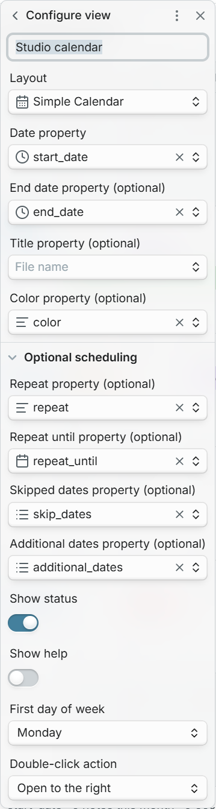

### Repeating notes

There are two separate choices:

1. **In the note**, add a **Text** property such as `repeat` and give it a value such as `every week`.
2. **In the Base view**, expand **Optional scheduling** and select `repeat` as **Repeat property**. This selects the **property name**, not the frequency. Each note supplies its own frequency through that property's value.

The main date is the first occurrence and its anchor. A Monday main date with `every week` repeats on Mondays. Every occurrence opens the original note; no files are duplicated. Durations and written times are preserved.

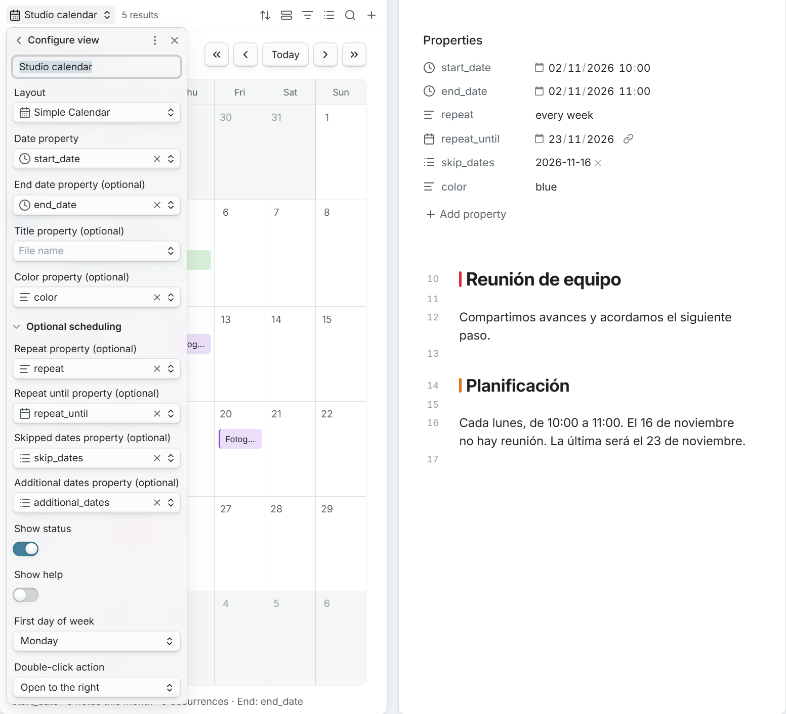

**`weekly` and `every week` are equivalent.** The plugin recognizes a small, explicit English grammar, case-insensitively, with these aliases:

| Frequency | Word form | Equivalent phrase | Compact form |
| --- | --- | --- | --- |
| Every day | `daily` | `every day` | `d` |
| Every week | `weekly` | `every week` | `w` |
| Every month | `monthly` | `every month` | `m` |
| Every year | `yearly` | `every year` | `y` |

For intervals, use a positive whole number from 1 to 9999: `every 3 days`, `every 2 weeks`, `every 3 months` or `every 2 years`. Compact equivalents are `d3`, `w2`, `m3` and `y2`. The words `second`, `third` and `fourth` are also accepted: `every second week` equals `w2`, and `every third month` equals `m3`.

This is a defined set of patterns, not unrestricted natural-language interpretation. Other languages and combined rules such as `m3d4` are unsupported. An invalid rule shows the source event once with a status warning. Monthly/yearly repeats clamp to the last day using the original anchor (Jan 31 → Feb 28 → Mar 31).

**There is no frequency dropdown in this version.** You enter the repeat value in the note's Properties editor or frontmatter. The date pickers described below edit the final date, skipped days and additional days; they do not select the frequency.

To finish or skip dates, create optional **Date** and **List** properties in Obsidian's native Properties editor, then select them as **Repeat until property** and **Skipped dates property**. These selectors appear only after a Repeat property is selected. From a repeating note's context menu, or its agenda three-dot button, choose **Repeat options…** to use date pickers. Only the configured fields are shown; Cancel writes nothing.

```yaml
---
start_date: 2026-11-02 10:00
end_date: 2026-11-02 11:00
repeat: every week
repeat_until: 2026-11-23
skip_dates:
  - 2026-11-16
---
```

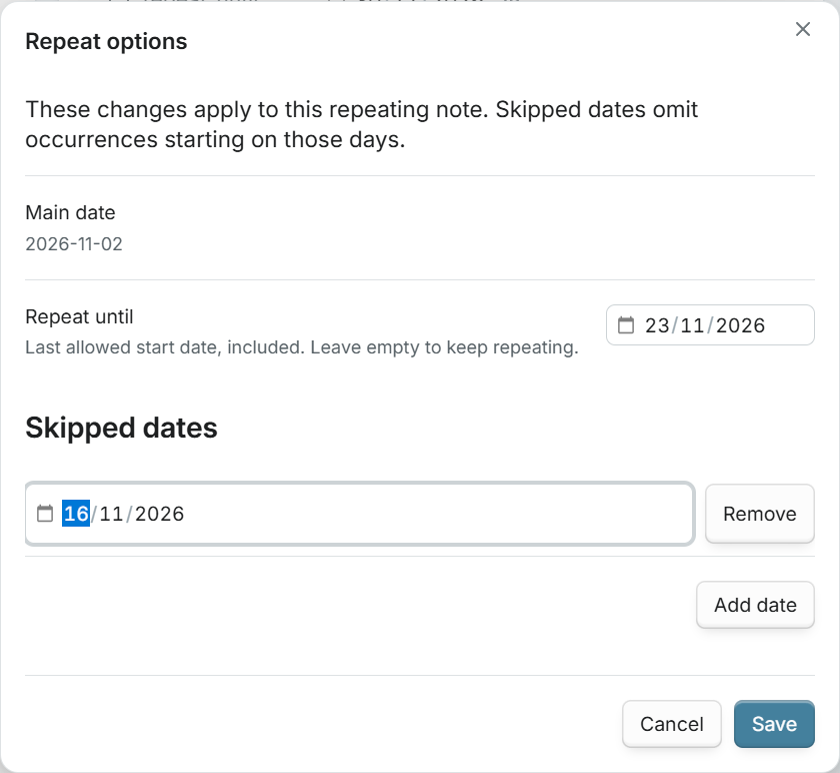

Save these options to show the meeting on **November 2, 9 and 23**: November 16 is skipped, and the series stops after November 23. Its one-hour duration stays the same.

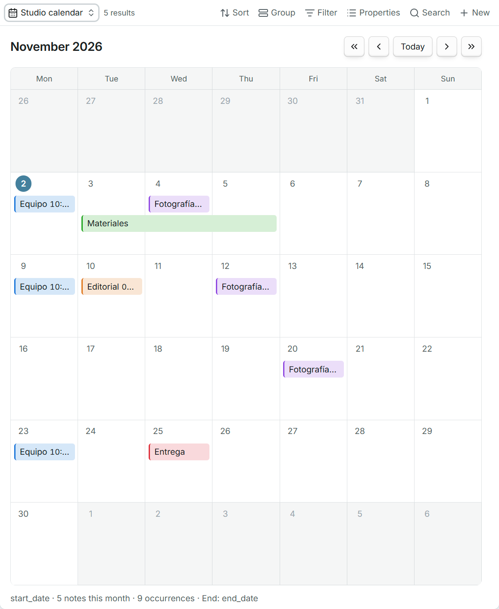

The final date is inclusive and applies to an occurrence's **start**, as do skipped dates. An occurrence can finish after that final date if it lasts several days. Skipping one occurrence never shifts later ones. Clear the end field to keep repeating; remove skipped rows to restore those occurrences. Limits do not affect ordinary, non-repeating notes. Invalid limits show the source event once with a warning rather than projecting an accidentally unbounded series. Repair malformed stored dates in the note before using the editor.

Projection is restricted to loaded dates and capped at 500 occurrences per note. A status warning reports the limit. Recurring bars cannot be dragged or resized: edit the source note to change the series.

### Additional dates for one note

For a course with irregular sessions, keep its normal main date and add individual days. This is opt-in and applies only to **single-day notes without repetition**.

1. Add a **List** property, for example `additional_dates`, to a note using Obsidian's native Properties editor.
2. Select it as **Additional dates property** under **Optional scheduling** in the Base view.
3. Use the note's **Additional dates…** menu action to add or remove days with native date pickers, then Save. You do not need to write a date-list syntax.

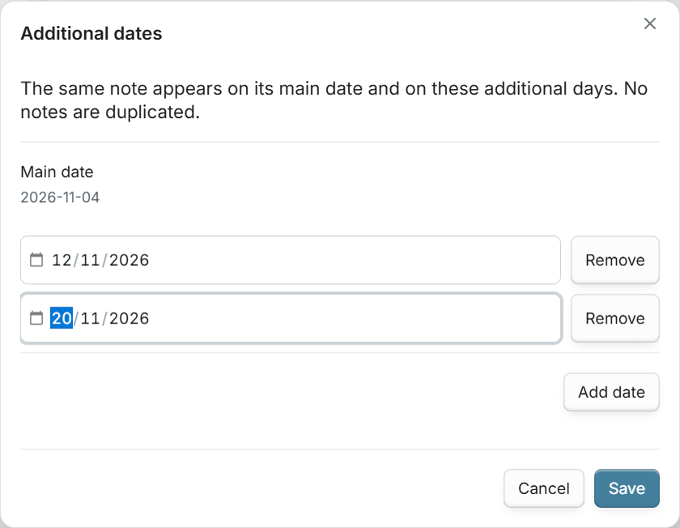

```yaml
---
start_date: 2026-11-04 18:00
end_date: 2026-11-04 20:00
additional_dates:
  - 2026-11-12
  - 2026-11-20
---
```

The course appears on November 4, 12 and 20, from 18:00 to 20:00, as in the calendar above. Every appearance opens **the same file**. Notes with no additional dates work as usual. The main date remains an ordinary Date/Datetime property; no scalar date is converted into a list. Duplicate days, including the main day, appear only once. The editor sorts and deduplicates saved days, retaining the main date and unrelated note properties/body. A one-value date property is also accepted as an additional day.

Additional days reuse the main event's written times, when present. They do not extend a multi-day range, combine with a repeat rule or inherit repeat limits. If such a combination is entered manually, the original range/series is retained and a warning explains why the additional dates were ignored. All appearances of an additional-date note stay non-draggable to avoid ambiguous changes to the main date or the complete schedule; use the date editor or the original note.

Date lists use `YYYY-MM-DD`, with up to 128 stored values. Native date pickers display your device's local format and save ISO days. Ambiguous strings such as `02/11/2026` are not guessed. Malformed or oversized stored lists are reported and cannot be silently rewritten by the date editor. If the schedule, note path or selected properties change while an editor is open, saving is refused and the draft stays available for review.

Base filters still decide which notes are supplied. For example, a filter on the main date can exclude a note even if one of its additional/repeated dates falls in the visible period. Use a suitable folder/tag filter when you want the complete schedule of those notes.

Optional times such as `2026-09-21 15:00` and `2026-09-21 18:00` appear beside the title. Date-only events remain all-day. **Show status** and **Show help** independently hide the footers and default to enabled.

## License

[MIT](LICENSE). Copyright 2026 David Hurtado.
